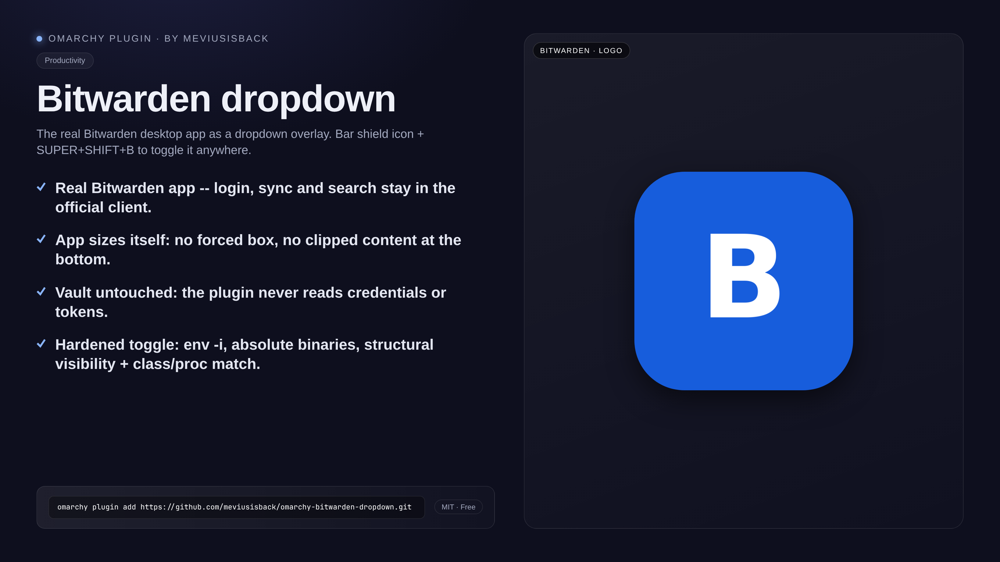

<div align="center">

# Bitwarden dropdown

**The real Bitwarden desktop app as an overlay dropdown: shield icon in the bar and `SUPER + SHIFT + B` toggle from anywhere.**

[](https://github.com/meviusisback/omarchy-bitwarden-dropdown/releases)
[](LICENSE)




</div>

## Why it exists

You need your password manager everywhere, but opening its window breaks the flow:
occupied workspace, lost focus, a window to close again. This plugin treats the
official Bitwarden app as a dropdown: one keypress and it appears over what you
are doing, another and it is gone. Login, sync and search stay in the official
app — no CLI, no session token in the plugin.

## What it does

- **Bar widget** (`BarWidget.qml`, plugin `meviusisback.bitwarden`): shield
  button, click = toggle, state probed every 2 s. It never touches secrets: it
  only reads `VISIBLE=0/1` and never logs raw output.
- **Dropdown on a special workspace**: the Bitwarden window lives hidden and
  appears as an overlay when you call it, from any workspace.
- **Global keybind `SUPER + SHIFT + B`** → `~/.local/bin/bitwarden-dropdown toggle`.
- **Simple close**: press `SUPER + SHIFT + B` again. If you have
  `special_fallthrough` enabled (already set by the dropdown-terminal plugin),
  just clicking outside is enough.
- **No secrets touched**: login and vault stay in the Bitwarden app. The
  script only asks the compositor whether the window exists and where it is.

## Install

```bash
omarchy plugin add https://github.com/meviusisback/omarchy-bitwarden-dropdown.git
omarchy plugin enable meviusisback.bitwarden
cd ~/.config/omarchy/plugins/meviusisback.bitwarden
./install.sh
```

`install.sh` is idempotent (marked blocks, never duplicated) and only installs
the window rule + keybind:

1. copies `bitwarden-dropdown` to `~/.local/bin/` (mode 755, verified with `cmp`)
2. copies `hypr/bitwarden.lua` to `~/.config/hypr/`
3. adds the load hook to `~/.config/hypr/hyprland.lua`
4. adds the `SUPER + SHIFT + B` keybind to `~/.config/hypr/bindings.lua`
5. `hyprctl reload` + `hyprctl configerrors` check + assert of exactly 1 bind

Then place the widget: `omarchy bar put meviusisback.bitwarden --section right`.

## Usage

- `SUPER + SHIFT + B` anywhere: if the app runs hidden it shows it, if visible
  it hides it, if not running it launches it.
- Click the shield in the bar: same thing.
- To close: `SUPER + SHIFT + B` again, or click outside if you have
  `special_fallthrough` enabled.

## Requirements

- Omarchy with Hyprland 0.56+ (Lua dispatcher syntax)
- Bitwarden desktop app installed (`bitwarden` from pacman, command
  `/usr/bin/bitwarden-desktop`). **Flatpak/AUR**: if you use another
  installation, change `LAUNCH` at the top of `bitwarden-dropdown` and the class
  in `hypr/bitwarden.lua` if different (check it with `hyprctl clients -j`).
- **"Close to tray" must be disabled** in Bitwarden Settings → App,
  otherwise closing the window sends it to the tray without mapping and the
  toggle cannot restore it (it exits with a non-fatal warning).
- Nerd Font for the shield icon in the bar

## Configuration

- Keybind `SUPER + SHIFT + B` (manifest default): lives in
  `~/.config/hypr/bindings.lua`, installed by `install.sh`.
- Launch command: `LAUNCH` variable at the top of `bitwarden-dropdown`
  (default `/usr/bin/bitwarden-desktop`).
- Window class: `hypr/bitwarden.lua` (default `Bitwarden`,
  case-insensitive match).

## How it works

- `hypr/bitwarden.lua` — window rule: the `Bitwarden` class goes to
  `special:bitwarden`, floating, centered under the bar. The size is NOT
  forced: the Bitwarden app decides its size and adapts the layout (forcing a
  fixed 70%x50% box cut off the content at the bottom).
- `bitwarden-dropdown` — toggle script: if the app runs hidden it shows it,
  if visible it hides it, if not running it launches it
  (`/usr/bin/bitwarden-desktop`, pacman). It uses the Hyprland 0.56 Lua
  dispatcher syntax (`hl.dsp.workspace.toggle_special`); the legacy
  `togglespecialworkspace` fails silently on this build.
- Security: the plugin **never reads** the Bitwarden vault, passwords or
  config — only window state via the compositor (`hyprctl`), with capped
  output (4 MB) and a deadline (`timeout -k`). The toggle runs under `env -i`
  with an explicit allowlist (converged for every invocation path, including
  the keybind), absolute binaries, `python3 -I -E -s`. Window matching is on
  `class` (case-insensitive) **and** verifies that `/proc/<pid>/cmdline`
  mentions `bitwarden` (defends against class-spoof); `VISIBLE` is decided
  structurally from `specialWorkspace.name` (defends against rename-spoof).
  `flock` single-flight on the toggle (the keybind runs outside the QML
  process).
- Difference from the rest of the marketplace: the Omarchy marketplace already
  has `io.github.elevate08.qs-bitwarden-cli` and `com.aktivesolutions.bw-vault`
  (bw CLI, verified). This plugin is the only one that treats **the Bitwarden
  GUI app as a dropdown** (same pattern as the Ente Auth plugin).

Tests (hermetic suite: stdlib, no compositor/network — extracts the real
Python helpers from the script and drives them with JSON fixtures):

```bash
python3 -m unittest discover -s tests -v
```

Covers class matching, charset-validation of the workspace name, class-spoof
via /proc, structural visibility parsing, rename-spoof and hostile fixtures
(garbage, oversized, unicode).

## Removal

```bash
cd ~/.config/omarchy/plugins/meviusisback.bitwarden
./install.sh uninstall
omarchy plugin disable meviusisback.bitwarden
omarchy plugin remove meviusisback.bitwarden
```

Removes script, rule, hook and keybind, then `hyprctl reload`. Only a `*.bak`
backup remains if one was created (delete it by hand if unneeded).

## License

MIT — see [LICENSE](LICENSE).
